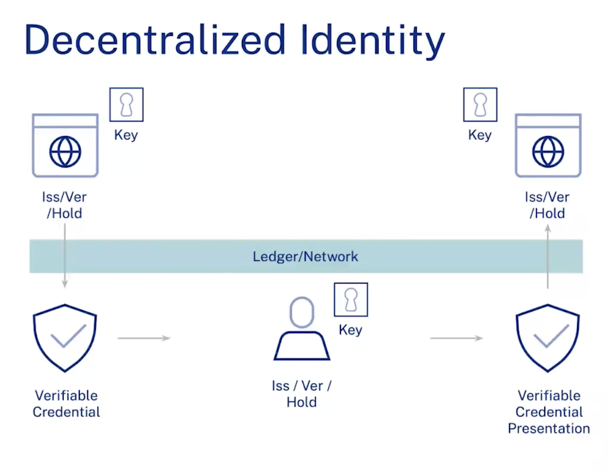
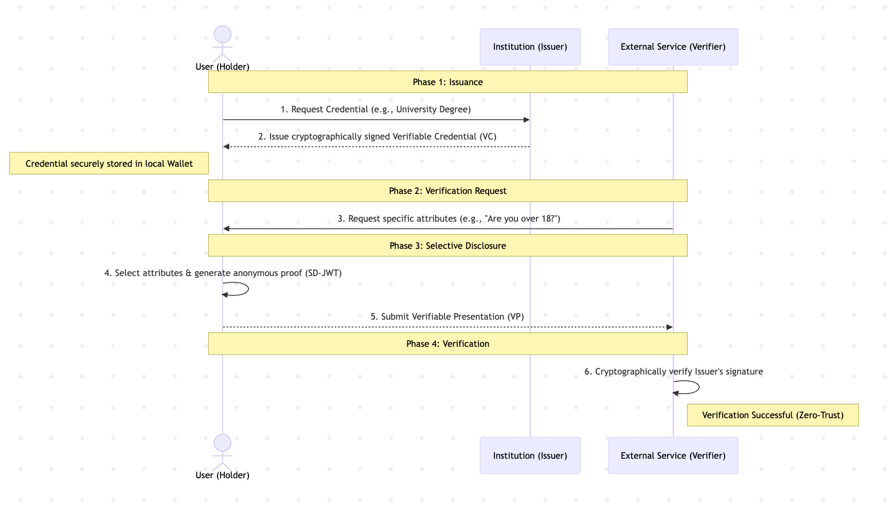

# CredSafe

## Problem Statement
Traditional digital identity systems force users to rely on centralized authorities that store and control their personal data, leading to severe privacy risks, data breaches, and a lack of user autonomy. There is a need for a decentralized identity framework that empowers users to hold and selectively disclose their verifiable credentials without depending on centralized databases.

## Users & Context
**Users:**
- **Holders (Individuals):** People who want to securely store their personal records (e.g., degrees, age, employment data) and selectively share them.
- **Issuers (Institutions):** Organizations like universities or employers who create and cryptographically sign official data.
- **Verifiers (Services):** Third-party apps or entities (e.g., banks, HR departments) that need to verify specific user data with zero-trust cryptographic guarantees.

**Context:** The application acts as a decentralized wallet and verifiable credential portal built on the Algorand blockchain and W3C standards.

## Solution Overview
CredSafe implements the "Triangle of Trust" (Issuer, Holder, Verifier) in Decentralized Identity.

 

1. **Issuer Portal:** Generates W3C Verifiable Credentials (VCs) using the Veramo SDK and issues them to the user.
2. **User Wallet (Frontend):** Manages Decentralized Identifiers (DIDs) anchored on Algorand smart contracts. The holder stores credentials locally.
3. **Verifier Portal:** External entities dispatch Verification Requests. The user can then authorize specific attributes via Selective Disclosure (SD-JWT), mathematically concealing unshared data.



## Setup & Run
1. **Clone & Install:**
   ```bash
   git clone https://github.com/utkarshc06/CredSafe_Devday.git
   cd CredSafe
   ```
2. **Backend (Identity Service):**
   Requires Node.js for Veramo SDK server.
   ```bash
   cd projects/Docvault-identity/wrapper
   npm install
   node server.js
   ```
   *Runs on `http://localhost:3001`*

3. **Frontend (Wallet Web App):**
   ```bash
   cd projects/Docvault-frontend
   npm install --legacy-peer-deps
   npm run dev
   ```
   *Runs on `http://localhost:3000`*

4. **Algorand Setup:**
   Ensure you have a Pera wallet configured for TestNet with funds from the Algorand Dispenser.

## Models & Data
- **Data Standards:** Utilizes W3C Verifiable Credentials Data Model v1.1.
- **Identifiers:** `did:algo` via Algorand anchoring, and `did:key` for issuers.
- **Storage:** Employs Zustand `persist` for local storage handling of credentials to ensure data remains completely client-side in the Holder's wallet.
- **Signatures:** Uses SD-JWT (Selective Disclosure JSON Web Tokens) and Ed25519 cryptography for zero-trust proof verification.
- *Note: This project does not utilize AI/ML models; "Models" refers entirely to standard DID and VC schema definitions.*

## Evaluation & Guardrails
- **Data Minimization:** Privacy-preserving Selective Disclosure (SD-JWT) guarantees verifiers only see the explicit attributes they request (e.g., age verified without revealing exact birth date).
- **Cryptographic Security:** Every presentation requires a cryptographic signature match; mock or altered JWTs immediately fail verification in the Verifier dashboard.
- **Decentralized Storage:** No central database stores user credentials, eliminating honey-pot data breach risks.

## Known Limitations & Risks
- **TestNet Dependency:** The current prototype relies heavily on the Algorand TestNet infrastructure; network downtimes can halt DID creation.
- **Smart Contract Funding:** The primary Algorand Identity Registry app account must be funded with ALGO to process the Minimum Balance Requirement (MBR) for storage boxes; users are directed to the dispenser if it runs dry.
- **Key Recovery:** Currently, local storage persists credentials, but full secure enclave key export/recovery mechanisms are out of scope for the current MVP.
- **Institutional Onboarding:** While technically robust, onboarding major institutions and government entities as official decentralized Issuers requires significant regulatory, legal, and operational overhead that goes beyond the technical implementation.

## Team
- **Utkarsh:**
  - GitHub: [@Utkarshc06](https://github.com/Utkarshc06)
- **Kaustubh:**
  - GitHub: [@Kaustubh2512](https://github.com/Kaustubh2512)
- **Viraj:**
  - GitHub: [@0xYuvi](https://github.com/virajghangale)
- **Mugdha:**
  - GitHub: [@0xYuvi](https://github.com/mugdhaa0307)
    
## Inspiration & Sources
- **[Privado ID (formerly Polygon ID)](https://privado.id/):** For their heavy influence and groundwork in defining zero-knowledge capable, decentralized trust triangles. Their concepts on verifier dashboards highly influenced our Verifier Portal flow.
- **[W3C Verifiable Credentials Data Model v1.1](https://www.w3.org/TR/vc-data-model/):** The core schema standard ensuring interoperability.
- **[Veramo SDK](https://veramo.io/):** For local environment DID/Key management and cryptographic JWT/JWS issuance.

---

## Original AlgoKit Documentation

This starter full stack project has been generated using AlgoKit. See below for default getting started instructions.

## Setup

### Initial setup
1. Clone this repository to your local machine.
2. Ensure [Docker](https://www.docker.com/) is installed and operational. Then, install `AlgoKit` following this [guide](https://github.com/algorandfoundation/algokit-cli#install).
3. Run `algokit project bootstrap all` in the project directory. This command sets up your environment by installing necessary dependencies, setting up a Python virtual environment, and preparing your `.env` file.
4. In the case of a smart contract project, execute `algokit generate env-file -a target_network localnet` from the `Docvault-contracts` directory to create a `.env.localnet` file with default configuration for `localnet`.
5. To build your project, execute `algokit project run build`. This compiles your project and prepares it for running.
6. For project-specific instructions, refer to the READMEs of the child projects:
   - Smart Contracts: [Docvault-contracts](projects/Docvault-contracts/README.md)
   - Frontend Application: [Docvault-frontend](projects/Docvault-frontend/README.md)

> This project is structured as a monorepo, refer to the [documentation](https://github.com/algorandfoundation/algokit-cli/blob/main/docs/features/project/run.md) to learn more about custom command orchestration via `algokit project run`.

### Subsequently

1. If you update to the latest source code and there are new dependencies, you will need to run `algokit project bootstrap all` again.
2. Follow step 3 above.

## Tools

This project makes use of Python and React to build Algorand smart contracts and to provide a base project configuration to develop frontends for your Algorand dApps and interactions with smart contracts. The following tools are in use:

- Algorand, AlgoKit, and AlgoKit Utils
- Python dependencies including Poetry, Black, Ruff or Flake8, mypy, pytest, and pip-audit
- React and related dependencies including AlgoKit Utils, Tailwind CSS, daisyUI, use-wallet, npm, jest, playwright, Prettier, ESLint, and Github Actions workflows for build validation

### VS Code

It has also been configured to have a productive dev experience out of the box in [VS Code](https://code.visualstudio.com/), see the [backend .vscode](./backend/.vscode) and [frontend .vscode](./frontend/.vscode) folders for more details.

## Integrating with smart contracts and application clients

Refer to the [Docvault-contracts](projects/Docvault-contracts/README.md) folder for overview of working with smart contracts, [projects/Docvault-frontend](projects/Docvault-frontend/README.md) for overview of the React project and the [projects/Docvault-frontend/contracts](projects/Docvault-frontend/src/contracts/README.md) folder for README on adding new smart contracts from backend as application clients on your frontend. The templates provided in these folders will help you get started.
When you compile and generate smart contract artifacts, your frontend component will automatically generate typescript application clients from smart contract artifacts and move them to `frontend/src/contracts` folder, see [`generate:app-clients` in package.json](projects/Docvault-frontend/package.json). Afterwards, you are free to import and use them in your frontend application.

The frontend starter also provides an example of interactions with your DocvaultClient in [`AppCalls.tsx`](projects/Docvault-frontend/src/components/AppCalls.tsx) component by default.

## Next Steps

You can take this project and customize it to build your own decentralized applications on Algorand. Make sure to understand how to use AlgoKit and how to write smart contracts for Algorand before you start.
=======
